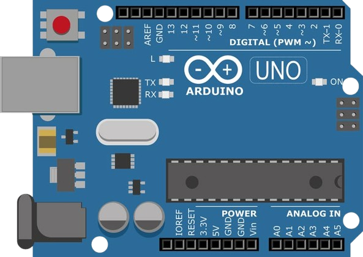
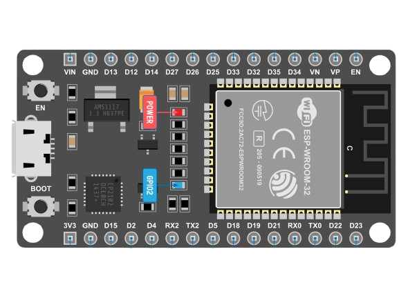
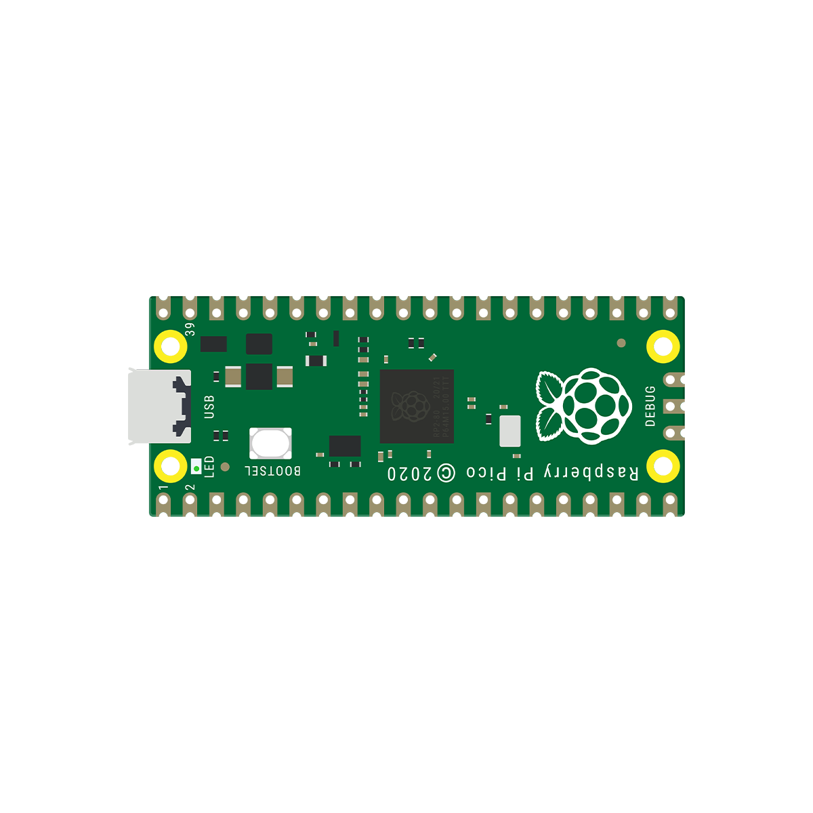
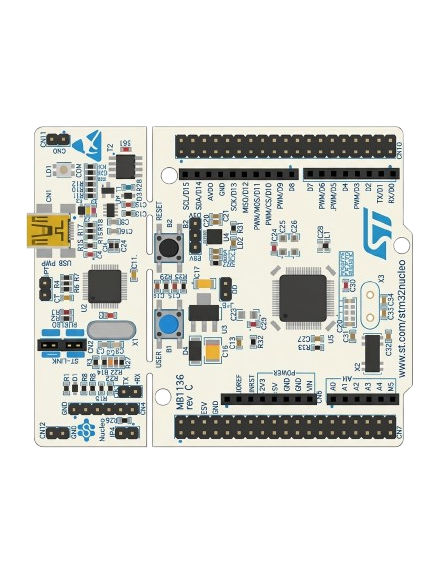

<!-- ===================== HEADER ===================== -->
<h1 align="center">
  
</h1>
About Me

I'm an aspiring **Embedded Systems Engineer** passionate about Embedded Hardware Development, PCB Design, and Microcontroller-Based Systems.

- Interested in Embedded C and Firmware Development.
- Hands-on experience in PCB Design and Hardware Development.
-  Exploring Microcontrollers, Sensors, and Embedded Systems.
-  Interested in UART, SPI, and I2C communication protocols.
-  Passionate about developing practical hardware and embedded solutions.
-  Continuously learning and improving my engineering skills.

<!-- TECHNICAL SKILLS -->

<h2 align="left">
  Technical Skills
</h2>

<h3 align="left"> Programming Languages</h3>

  
   
  
  

<!-- Microcontrollers & Development Boards -->

<h3 align="left">Microcontrollers & Development Boards</h3>

<table>
  <tr>
    <td align="center">
      
    </td>
    <td align="center">
      
    </td>
    <td align="center">
      
    </td>
    <td align="center">
      
    </td>
  </tr>
  <tr>
    <td align="center"><b>Arduino UNO</b></td>
    <td align="center"><b>ESP32</b></td>
    <td align="center"><b>Raspberry Pi Pico W</b></td>
    <td align="center"><b>STM32</b></td>
  </tr>
</table>

<h3 align="left"> Communication Protocols</h3>

  
  
  
  
  

<h3 align="left"> PCB Design</h3>

  
  
  
  

<h3 align="left"> Tools & Platforms</h3>

  
  
  
  

<!-- CONNECT WITH ME -->

<h2 align="left"> Connect With Me</h2>

  
  &nbsp;&nbsp;&nbsp;
  
  &nbsp;&nbsp;&nbsp;
  

<h1 align="center">
  
</h1>
